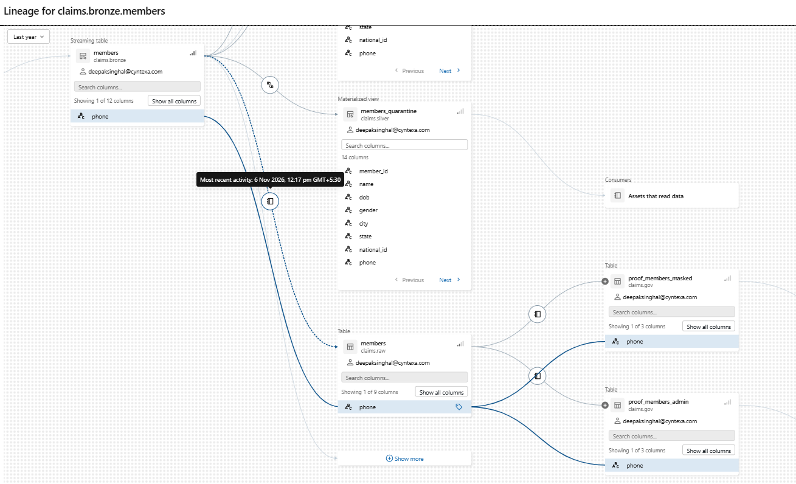

# R2 — Lineage answer

**Question:** full three-part names of the tables reading `claims.raw.members.phone`.

**Answer (column-level lineage, verified live 2026-11-05, re-verified 2026-11-06):**

1. `claims.gov.proof_members_admin`
2. `claims.gov.proof_members_masked`

**Lineage graph (actual Catalog Explorer column lineage, `claims.bronze.members.phone`, downstream):**

The actual Catalog Explorer lineage graph shows the same verified chain: `claims.bronze.members.phone` → `claims.silver.members_clean` / `claims.silver.members_quarantine` (materialized views, direct reads of bronze via `silver.sql`), and via `claims.raw.members` → `claims.gov.proof_members_admin` / `claims.gov.proof_members_masked`. No table reads `claims.silver.members_clean.phone` — its only recorded usage is ad-hoc notebook SELECTs (2026-11-03) — so the silver branch ends there (sources: Catalog lineage UI + `system.access.column_lineage` + `claims_pipeline/transformations/silver.sql`).

Both tables are created in the [R1 Access Control Governance](/editor/notebooks/3009055914259347) notebook (cell R1.6) to materialize the compliance proof of the `gov.mask_last4` column mask.

**Context from the same lineage record:**

- Upstream of `claims.raw.members.phone` is `claims.bronze.members.phone` (the raw table was materialized from bronze in cell R1.1) — bronze is a *source*, not a reader.
- `claims.silver.members_clean` and `claims.silver.members_quarantine` also carry `phone`, but they read `claims.bronze.members.phone` directly (via the `members_scored` view in `silver.sql`: `trim(phone)` into clean, `select *` into quarantine) — they do **not** read `claims.raw.members.phone`, so they are not part of the answer. Note: the lineage system table records the silver MVs' `phone` with a NULL source (unattributed through the pipeline temp view); the bronze to silver edge is verified from the `silver.sql` source code. `claims.silver.members_clean.phone` itself has no downstream table consumers — only ad-hoc notebook SELECTs — so the silver phone branch ends at the MVs.
- No `claims.gold.*` table reads `phone` at all: `claims.gold.claims_enriched` carries only `member_id`, and its columns are state-filtered by `claims.gov.claims_state_filter`, not PII-masked.
